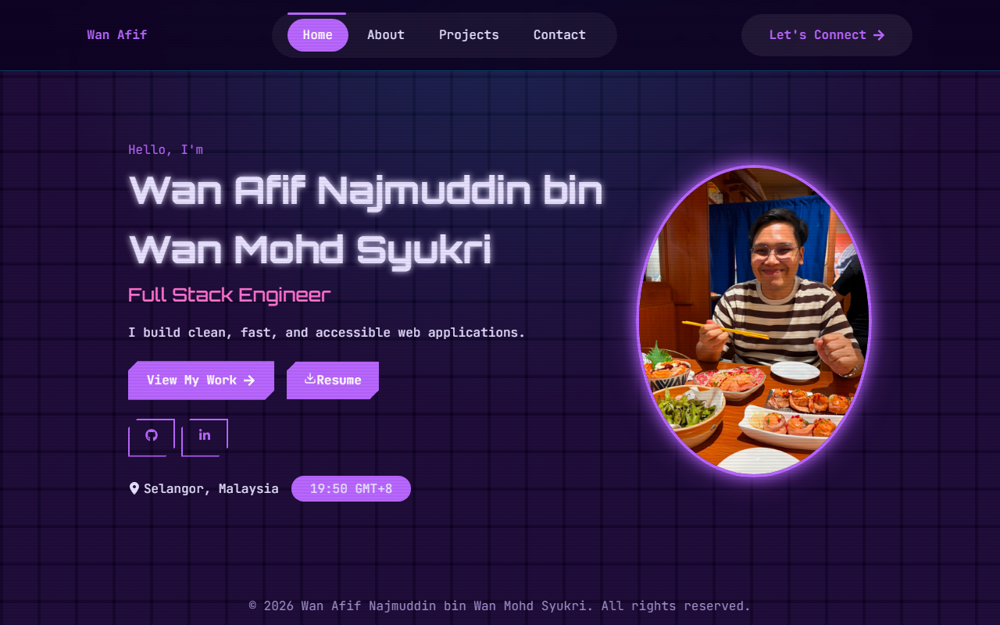

# Wan Afif · Personal Portfolio

A visual, "Synthwave Purple"-themed Full Stack Engineer portfolio (Home, About, Projects,
Contact) built with **React 19 + Vite**. Live at
**[wan-afif.netlify.app](https://wan-afif.netlify.app/)**.



## Features

- **"Synthwave Purple" cyberpunk theme** — Orbitron + JetBrains Mono fonts, perspective
  grid & scanline overlays, glow, cut-corner buttons, and an RGB-split glitch on the hero
  name, all gated behind `prefers-reduced-motion`
- **Data-driven content** — profile, projects, certifications, and work experience all live
  in `src/data/`, so site text is edited without touching component code
- **Projects showcase** carousel (react-slick)

## Tech Stack

- **React 19** + **Vite 8** (CSS Modules per component; global theme in `src/styles/index.css`)
- **react-router-dom** for client-side routing
- **react-icons**, **react-slick** + **slick-carousel**
- **ESLint** (`eslint-plugin-react-hooks`, `eslint-plugin-react-refresh`)

## Getting Started

```bash
# Clone
git clone https://github.com/afuuuuf/portfolio.git
cd portfolio

# Install dependencies (Node 20.19+ or 22.12+, as required by Vite 8)
npm install

# Start the dev server (opens the browser)
npm run dev

# Lint
npm run lint

# Production build → /dist
npm run build

# Preview the production build
npm run preview
```

## Project Structure

```
src/
├── components/
│   ├── common/    Button, Carousel, Clock, SocialIcons, TechIcons
│   ├── layout/    Navbar, Footer
│   └── sections/  Hero, About, Contact, ProjectShowcase
├── data/          profile, projects, certs, work experience (edit content here)
├── pages/         Home, About, Project, Contact
├── styles/        global theme & palette
└── utils/         file, time helpers
```

## Theming

The site ships with two cyberpunk palettes defined side-by-side in
`src/styles/index.css` `:root` — the active one on top, the alternative commented out.
Component styles use the palette CSS variables, so switching themes is a one-block edit.
The currently active palette is **Synthwave Purple** (`#0D0221` bg, `#B967FF` primary,
`#FF71CE` pink, `#01CDFE` cyan).

## Deploy & SPA Routing

Deployed to **Netlify as a static site** from the `main` branch. Production build output is
`dist/`. SPA routing is handled via `public/_redirects`.

## License

Code is MIT-licensed (see [LICENSE](LICENSE)); content, text, and images are © Wan Afif and
not for reuse.

## Author

**Wan Afif Najmuddin bin Wan Mohd Syukri** · Full Stack Engineer
